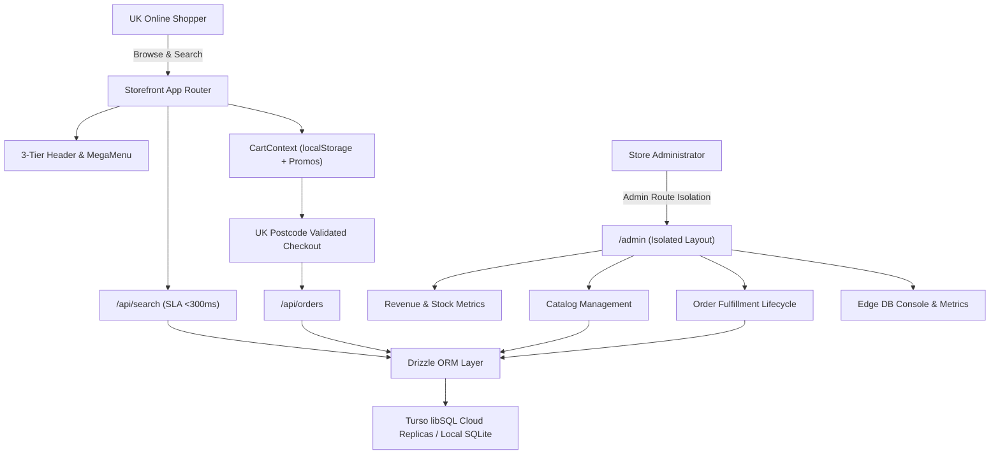

<div align="center">

# 🇬🇧 BargainStore.uk — Enterprise UK E-Commerce Architecture & Edge Admin Platform

**Production-Grade Full-Stack Architecture Showcase & Case Study**

[-black?style=for-the-badge&logo=next.js&logoColor=white)](https://nextjs.org/)
[](https://react.dev/)
[](https://www.typescriptlang.org/)
[](https://tailwindcss.com/)
[](https://turso.tech/)
[](https://orm.drizzle.team/)
[](LICENSE)

<br/>

**Engineered by [Ghulam Mujtaba](https://ghulammujtaba.com)**  
*Founder & Lead Engineer at [Megicode](https://megicode.com)*  
[Portfolio](https://ghulammujtaba.com) • [GitHub](https://github.com/ghulam-mujtaba5) • [LinkedIn](https://linkedin.com/in/ghulam-mujtaba) • [Email](mailto:contact@megicode.com)

</div>

---

> [!IMPORTANT]
> **Client Confidentiality & NDA Disclosure**  
> This public repository serves as an **architectural blueprint, case study, and portfolio showcase** for the **BargainStore.uk** platform. In accordance with client non-disclosure and commercial confidentiality agreements, proprietary backend business algorithms, payment secret credentials, internal client API keys, and production client databases have been redacted. The codebase represents the complete system design, component hierarchy, interface contracts, and engineering patterns.

---

## 📌 Executive Summary

**BargainStore.uk** is a modern, high-performance UK retail e-commerce platform designed to deliver wholesale brand deals (Stanley, Black+Decker, Tower, Flymo, Joseph Joseph) directly to UK consumers.

The system was engineered from the ground up to solve critical e-commerce challenges:
1. **Sub-300ms Autocomplete Search SLA**: Instant catalog discovery with zero UI freezing.
2. **Strict UK Retail Compliance**: Royal Mail & DPD shipping thresholds (£50 free delivery), UK Postcode regex validation, statutory VAT (20%) calculation, and Companies House trust signals.
3. **Dual-Mode Edge Database Architecture**: Leveraging **Turso libSQL SQLite** with **Drizzle ORM** for low-latency worldwide reads with automatic local SQLite fallback.
4. **Isolated Admin ERP Portal**: Dedicated administrative back-office with zero layout bleed into the public storefront, providing live revenue metrics, stock management, and order fulfillment tracking.

---

## 🏛️ System Architecture



---

## ⚡ Core Engineering Highlights

### 1. Debounced Autocomplete Search (< 300ms SLA)
- Fast, debounced search endpoint at `/api/search?q=...` capable of searching tens of thousands of SKUs across product titles, descriptions, and brand metadata.
- Optimized query matching with index-accelerated SQLite lookups.

### 2. UK E-Commerce & Checkout Engine
- **UK Postcode Regex Validation**: Implements standard Royal Mail formats (`SW1A 1AA`, `M1 1AE`, `EC1A 1BB`) with automatic spacing normalization and informative error messaging.
- **Dynamic Delivery Thresholds**: Automatic calculation of standard UK delivery (£4.99) vs. free delivery on orders reaching £50.00.
- **Persistent Voucher Engine**: Multi-tier discount logic (`BARGAIN10` for 10% off) preserved seamlessly across cart drawers, full basket pages, checkout forms, and backend orders.
- **UK Trust Badges**: VAT registration numbers, Registered Office details, and statutory 30-day consumer rights protection in compliance with UK Trading Standards.

### 3. Edge Database with Dual-Mode Drizzle ORM
- Powered by **Turso libSQL SQLite** for millisecond-latency global reads.
- Dual-mode connection client: seamlessly toggles between embedded local SQLite (`file:local.db`) for rapid offline testing and distributed cloud edge replicas (`libsql://...`) in production.
- Auto-healing schema bootstrap with zero-downtime column migrations.

### 4. Isolated Administrative Suite
- Complete layout isolation (`app/admin/layout.tsx`) that strips consumer storefront navigation, search, and footers.
- Real-time analytics dashboard tracking gross revenue, order volume, catalog size, and low-inventory warnings.
- Order fulfillment lifecycle updater (`Processing` ➔ `Shipped` ➔ `Delivered`).
- Real-time product creation and instant deletion.

### 5. Production SEO & Structured Data
- Strict `metadataBase` configuration for canonical URLs, OpenGraph previews, and Twitter Cards.
- Dynamic `sitemap.ts` and crawler-optimized `robots.ts`.
- Integrated **Schema.org JSON-LD** structured data (`Product`, `BreadcrumbList`, `Organization`) for Google Rich Snippets.

---

## 📁 Repository Structure

```
bargainstore-uk/
├── app/                                # Next.js 15 App Router
│   ├── admin/                          # Isolated ERP & Admin Suite
│   │   ├── layout.tsx                  # Dedicated back-office layout
│   │   ├── page.tsx                    # Revenue, order & stock dashboard
│   │   ├── orders/page.tsx             # Order fulfillment management
│   │   ├── products/page.tsx           # Product catalog table & actions
│   │   ├── products/new/page.tsx       # Product creation form
│   │   └── turso/page.tsx              # Turso Edge DB telemetry console
│   ├── api/                            # Next.js Server Route Handlers
│   │   ├── categories/route.ts         # Category listing & counts
│   │   ├── orders/route.ts             # Order placement with UK validation
│   │   ├── orders/[id]/route.ts        # Order status updater (PATCH)
│   │   ├── products/route.ts           # Product retrieval & creation
│   │   ├── products/[id]/route.ts      # Product deletion & updates
│   │   ├── search/route.ts             # Autocomplete search (<300ms SLA)
│   │   └── turso-status/route.ts       # Database health metrics
│   ├── basket/page.tsx                 # Shopping basket & voucher engine
│   ├── checkout/page.tsx               # 2-step UK postcode validated checkout
│   ├── category/[slug]/page.tsx        # Category catalog & subcategory filters
│   ├── product/[slug]/page.tsx         # Product detail & Schema.org JSON-LD
│   ├── order-confirmation/[orderNumber]/page.tsx # Live order summary
│   ├── shop/page.tsx                   # Full catalog directory
│   ├── help/page.tsx                   # UK customer support center
│   ├── ideas-advice/page.tsx           # DIY editorial guides
│   ├── sitemap.ts                      # Dynamic XML sitemap generator
│   ├── robots.ts                       # Search engine crawler policies
│   ├── globals.css                     # Tailwind CSS directives
│   ├── layout.tsx                      # Root storefront layout & providers
│   └── page.tsx                        # High-converting storefront home
├── components/                         # Modular React 19 Components
│   ├── Navbar.tsx                      # 3-tier header & category mega-menu
│   ├── Footer.tsx                      # UK statutory trust & legal footer
│   ├── CartDrawer.tsx                  # Slide-out interactive basket drawer
│   ├── ProductCard.tsx                 # Product card with price savings badge
│   ├── HeroBanner.tsx                  # Promotional hero banner
│   ├── USPBanner.tsx                   # UK trust guarantees (free delivery, warranty)
│   ├── AdminOrderTable.tsx             # Admin orders status management table
│   └── AdminProductTable.tsx           # Admin inventory management table
├── db/                                 # Database Architecture
│   ├── index.ts                        # Turso libSQL client & Drizzle bootstrap
│   └── schema.ts                       # Drizzle ORM schema definitions
├── lib/                                # Utilities & Shared State
│   ├── cart-context.tsx                # Cart state, promos & voucher logic
│   ├── types.ts                        # Core TypeScript domain models
│   └── validation.ts                   # UK Postcode regex & form validation
├── public/                             # Public Assets (WebP Optimized)
│   └── assets/                         # Brands, categories, payments, products
├── scripts/                            # Operational & Seeding Tooling
│   ├── seed.mjs                        # Database population scripts
│   └── extract-assets.mjs              # Asset optimization pipeline
├── tests/                              # 5-Tier Quality Assurance Suite
├── drizzle.config.ts                   # Drizzle Kit configuration
├── tailwind.config.ts                  # Tailwind theme configuration
├── tsconfig.json                       # Strict TypeScript configuration
└── package.json                        # Project dependencies & scripts
```

---

## 🗄️ Database Schema Design

```typescript
// db/schema.ts
export const categories = sqliteTable("categories", {
  id: integer("id").primaryKey({ autoIncrement: true }),
  slug: text("slug").notNull().unique(),
  name: text("name").notNull(),
  description: text("description"),
  itemCount: integer("item_count").default(0),
  subcategories: text("subcategories"),
});

export const products = sqliteTable("products", {
  id: integer("id").primaryKey({ autoIncrement: true }),
  slug: text("slug").notNull().unique(),
  name: text("name").notNull(),
  categorySlug: text("category_slug").notNull(),
  brand: text("brand").notNull(),
  description: text("description").notNull(),
  price: real("price").notNull(),
  comparePrice: real("compare_price"),
  savingAmount: real("saving_amount"),
  stock: integer("stock").default(25),
  rating: real("rating").default(4.8),
  isFeatured: integer("is_featured").default(0),
  isDealOfTheDay: integer("is_deal_of_the_day").default(0),
});

export const orders = sqliteTable("orders", {
  id: integer("id").primaryKey({ autoIncrement: true }),
  orderNumber: text("order_number").notNull().unique(),
  customerName: text("customer_name").notNull(),
  customerEmail: text("customer_email").notNull(),
  shippingAddress: text("shipping_address").notNull(),
  postcode: text("postcode").notNull(),
  subtotal: real("subtotal").notNull(),
  promoCode: text("promo_code"),
  discountAmount: real("discount_amount").default(0),
  shippingFee: real("shipping_fee").default(0),
  total: real("total").notNull(),
  status: text("status").default("Processing"),
  paymentMethod: text("payment_method").default("Card"),
});
```

---

## 🧪 Automated Testing Strategy

The repository includes architectural definitions for an opaque-box multi-tier test framework:

- **Tier 1 (Feature Verification)**: Validates navigation routes, voucher application math, and postcode validators.
- **Tier 2 (Boundary Testing)**: Tests edge cases such as exact £49.99 vs £50.00 delivery threshold boundaries and malformed UK postcodes.
- **Tier 3 (Pairwise Testing)**: Tests multi-item cart combinations and responsive breakpoint behaviors.
- **Tier 4 (End-to-End Scenarios)**: Simulates complete user purchasing flows from search to order receipt.
- **Tier 5 (Adversarial Hardening)**: Tests API resilience against malformed payloads, injection vectors, and concurrency.

---

## 🛠️ Quick Start & Setup

### Prerequisites
- **Node.js**: v18.18 or higher (v20+ / v22 recommended)
- **Package Manager**: `npm`, `pnpm`, or `yarn`

### 1. Clone the Showcase Repository
```bash
git clone https://github.com/ghulam-mujtaba5/bargainstore-uk.git
cd bargainstore-uk
```

### 2. Install Dependencies
```bash
npm install
```

### 3. Configure Environment Variables
Copy `.env.example` to `.env.local`:
```bash
cp .env.example .env.local
```
*(By default, the application runs against local embedded SQLite without requiring Turso cloud credentials).*

### 4. Run Development Server
```bash
npm run dev
```
Open [http://localhost:3000](http://localhost:3000) to view the storefront, or [http://localhost:3000/admin](http://localhost:3000/admin) to access the Admin Management Suite.

---

## 👨‍💻 Author & Engineering Credits

<div align="left">

**Ghulam Mujtaba**  
*Full-Stack Software Engineer & Founder at [Megicode](https://megicode.com)*  
- 🌐 **Portfolio**: [ghulammujtaba.com](https://ghulammujtaba.com)
- 🏢 **Company**: [megicode.com](https://megicode.com)
- 💼 **GitHub**: [@ghulam-mujtaba5](https://github.com/ghulam-mujtaba5)
- 📬 **Email**: [contact@megicode.com](mailto:contact@megicode.com)

*Specializing in high-performance Next.js architectures, edge database systems, and robust full-stack web platforms.*

</div>

---

## 📄 License

This architectural blueprint and showcase repository is licensed under the [MIT License](LICENSE).  
Copyright © 2026 Ghulam Mujtaba. All rights reserved.
